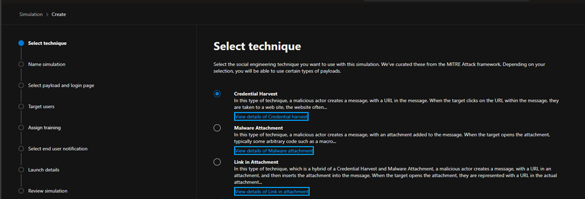
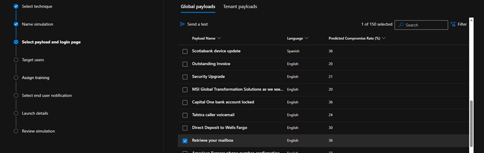
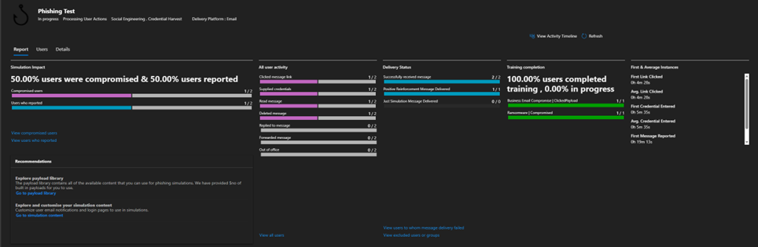

# Microsoft Defender – Phishing Simulation Lab

## Overview

This project documents a controlled phishing simulation conducted using Microsoft Defender for Office 365 Attack Simulation Training.

The purpose of the exercise was to explore how phishing simulations can be configured and used to assess user responses to simulated phishing attacks, identify potential security awareness gaps and deliver targeted security training.

The simulation used a credential-harvesting technique and a simulated email impersonating a mailbox storage warning. Two fictional test users were targeted in a sandbox tenant.

The exercise demonstrated how different users may respond to the same phishing attempt and how simulation results can be used to support security awareness training.

## Objectives

- Explore Microsoft Defender Attack Simulation Training.
- Configure and launch a credential-harvesting phishing simulation.
- Understand how simulated phishing emails and landing pages work.
- Review user interactions and campaign results.
- Explore automated security awareness training assignments.
- Evaluate how phishing simulations can support an organisation's security awareness programme.

## Lab Environment

| Component | Description |
|---|---|
| Platform | Microsoft Defender for Office 365 |
| Feature | Attack Simulation Training |
| Environment | Microsoft 365 sandbox tenant |
| Test users | Two fictional test accounts |
| Simulation technique | Credential harvesting |
| Phishing scenario | Simulated mailbox storage warning |

All activities were conducted in a controlled sandbox environment using fictional test users.

## Simulation Configuration

A credential-harvesting simulation was configured using Microsoft Defender Attack Simulation Training.

The selected phishing scenario impersonated a mailbox storage warning, encouraging recipients to interact with the simulated email.

The campaign was configured with a phishing landing page designed to simulate a credential submission scenario.

Two fictional test users in the sandbox tenant were selected as recipients.

Automated security awareness training was also configured as part of the simulation.

## Simulation Execution

After configuring the campaign, the phishing simulation was launched against the selected test users.

The exercise was designed to observe how recipients interacted with the simulated phishing email and whether they identified and reported it as suspicious.

The campaign results were subsequently reviewed in Microsoft Defender.

## Results and Analysis

The simulation produced two different user responses:

| Result | Outcome |
|---|---|
| Credentials submitted | 1 user |
| Phishing email reported | 1 user |
| Assigned training completed | 2 users |

This represented a 50% credential submission rate and a 50% reporting rate within the two-user test group.

The results demonstrated how users may respond differently to the same simulated phishing attempt.

One user interacted with the credential-harvesting page and submitted credentials, while the other correctly identified and reported the simulated phishing email.

Both users completed the assigned security awareness training.

### Key Observations

- The simulation demonstrated the potential effectiveness of credential-harvesting techniques.
- The reporting action showed the importance of encouraging users to recognise and report suspicious emails.
- Automated training provided a follow-up learning opportunity for users.
- Campaign reporting made it possible to review user interactions and training completion.

The results are illustrative only. With a sample of two test users, they cannot be used to draw conclusions about an organisation's overall phishing resilience or user awareness.

## Security Awareness and Key Learnings

This exercise provided practical experience with Microsoft Defender Attack Simulation Training and highlighted the role of security awareness in reducing phishing-related risks.

Key learnings included:

- Understanding how credential-harvesting simulations are configured and executed.
- Exploring how phishing landing pages can be used to simulate credential theft.
- Reviewing and interpreting phishing simulation metrics.
- Understanding the importance of user reporting in an organisation's phishing defence strategy.
- Exploring how automated security awareness training can be used to reinforce secure behaviour.

The exercise also demonstrated that technical security controls should be complemented by user awareness and education.

## Limitations

- The simulation involved only two fictional test users.
- The results represent a controlled lab exercise rather than a real organisational phishing assessment.
- The exercise focused on credential harvesting and did not evaluate other phishing techniques.
- The results do not measure long-term changes in user behaviour following security awareness training.

## Disclaimer

This project was conducted in a personal Microsoft 365 sandbox tenant using fictional test users and controlled simulation scenarios.

No real users, production systems or third-party organisations were targeted.

The screenshots are provided for educational and portfolio purposes. Sensitive information, credentials and tenant-specific identifiers have been removed or redacted.
